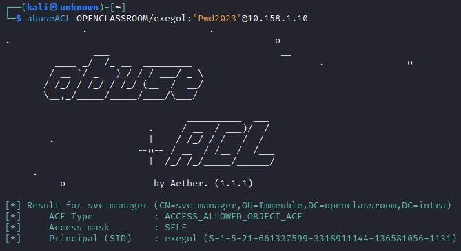
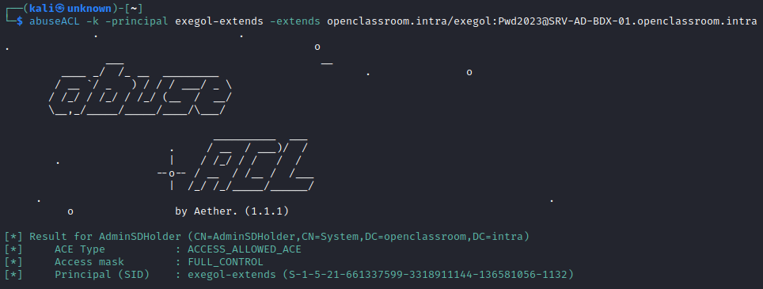
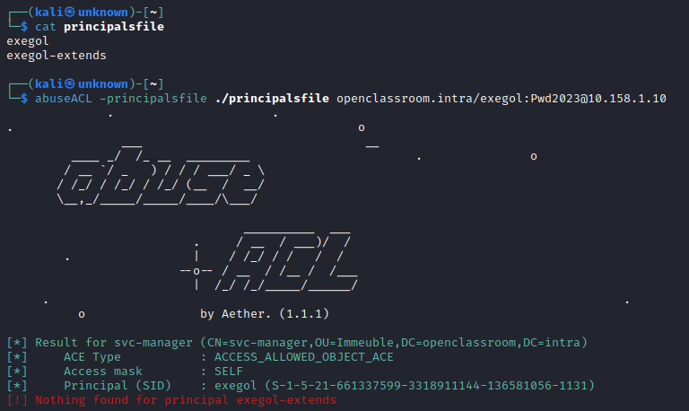
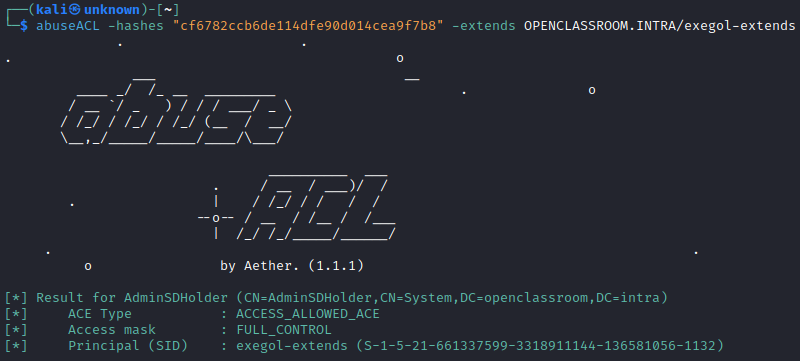

<p align="center">
    Un script de Python para enumerar automáticamente ACEs/ACLs vulnerables de Windows.
    <br>
    
    
    <a href="https://twitter.com/intent/follow?screen_name=san__yohan" title="Follow"></a>
    <br>
</p>

## Instalación

Puedes instalarlo desde PyPI (la última versión es ) con este comando:

```bash
sudo python3 -m pip install abuseACL
```

O desde el código fuente:

```bash
git clone https://github.com/AetherBlack/abuseACL
cd abuseACL
sudo python3 -m pip install -r requirements.txt
sudo python3 setup.py install
```

O con pipx:

```bash
python3 -m pipx install git+https://github.com/AetherBlack/abuseACL/
```

## Ejemplos

- Quieres enumerar las ACEs/ACLs vulnerables para el usuario actual:

```bash
abuseACL $DOMAIN/$USER:"$PASSWORD"@$TARGET
```



- Quieres enumerar las ACEs/ACLs vulnerables para otro usuario/equipo/grupo:

```bash
abuseACL -principal Aether $DOMAIN/$USER:"$PASSWORD"@$TARGET
```



- Quieres enumerar las ACEs/ACLs vulnerables para una lista de usuarios/equipos/grupos:

```bash
abuseACL -principalsfile accounts.txt $DOMAIN/$USER:"$PASSWORD"@$TARGET
```

Aquí tienes un ejemplo del contenido de `principalsfile`:

```
Administrateur
Group
aether
Machine$
```



- Quieres enumerar las ACEs/ACLs vulnerables en el Schema o en adminSDHolder:

```bash
abuseACL -extends $DOMAIN/$USER:"$PASSWORD"@$TARGET
```



Puedes consultar la documentación de [DACL](https://www.thehacker.recipes/a-d/movement/dacl) para saber cómo explotar los permisos y utilizar [dacledit](https://github.com/ThePorgs/impacket/blob/master/examples/dacledit.py) para explotar las ACEs.

## Cómo funciona

La herramienta se conectará al LDAP del DC para enumerar usuarios/grupos/equipos/OU/plantillas de certificados y su nTSecurityDescriptor, los cuales se analizarán para verificar la presencia de permisos vulnerables.

---

## Créditos

- [@_nwodtuhs](https://twitter.com/_nwodtuhs) por la útil documentación de [DACL](https://www.thehacker.recipes/a-d/movement/dacl)
- [@fortra](https://github.com/fortra/) por desarrollar [impacket](https://github.com/fortra/impacket)

## Licencia

[GNU General Public License v3.0](./LICENSE)
